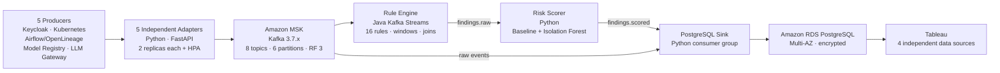

# AI Governance Audit Pipeline — Current Architecture

## Technical specification

| Layer | Current specification |
|---|---|
| Compute | Amazon EKS 1.36; three ARM `m7g.large` Spot workers |
| Containers | Eight Amazon ECR images, version `v2` |
| Adapters | FastAPI/Python; separate service per producer; two replicas each; HPA 2–6 |
| Streaming | Amazon MSK Kafka 3.7.x; three brokers; IAM authentication; TLS |
| Topics | Five producer topics, raw findings, scored findings and dead-letter |
| Kafka settings | Six partitions; replication factor 3; minimum ISR 2 |
| Rules | Java Kafka Streams; three replicas; `exactly_once_v2`; state stores, windows and joins |
| Compliance | 16 rules mapped to NIST AI RMF, ISO/IEC 42001, EU AI Act, NIST SP 800-53 and GDPR |
| Risk | Severity × frequency baseline compared with Isolation Forest |
| Storage | Amazon RDS PostgreSQL 18.3; Multi-AZ; encrypted; private subnets |
| Tableau | Separate sources for framework status, risk trend, incidents and latency |
| Security | IRSA roles, producer-specific topic access, private RDS/MSK and AWS Secrets Manager |

## End-to-end event flow

Native producer event → unified governance schema → producer Kafka topic → rule detection → framework mapping → risk scoring → PostgreSQL → Tableau dashboard.

## Kafka topics

- `governance.keycloak.v1`
- `governance.kubernetes.v1`
- `governance.pipeline.v1`
- `governance.model-registry.v1`
- `governance.llm-gateway.v1`
- `governance.findings.raw.v1`
- `governance.findings.scored.v1`
- `governance.dead-letter.v1`

## Tableau data sources

- `tableau_framework_status`
- `tableau_risk_trend`
- `tableau_incident_history`
- `tableau_pipeline_latency`

Each Tableau view is added as a separate data source. Their worksheets are combined at the dashboard level to avoid relationship and aggregation mismatches.
