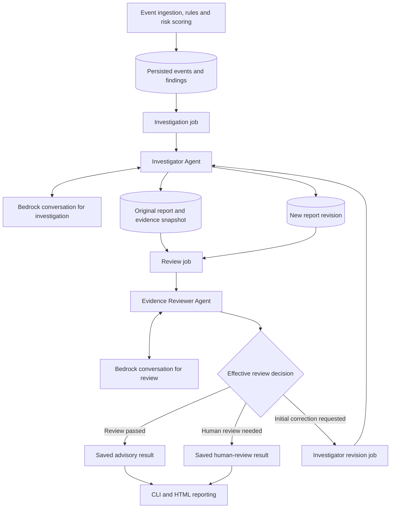
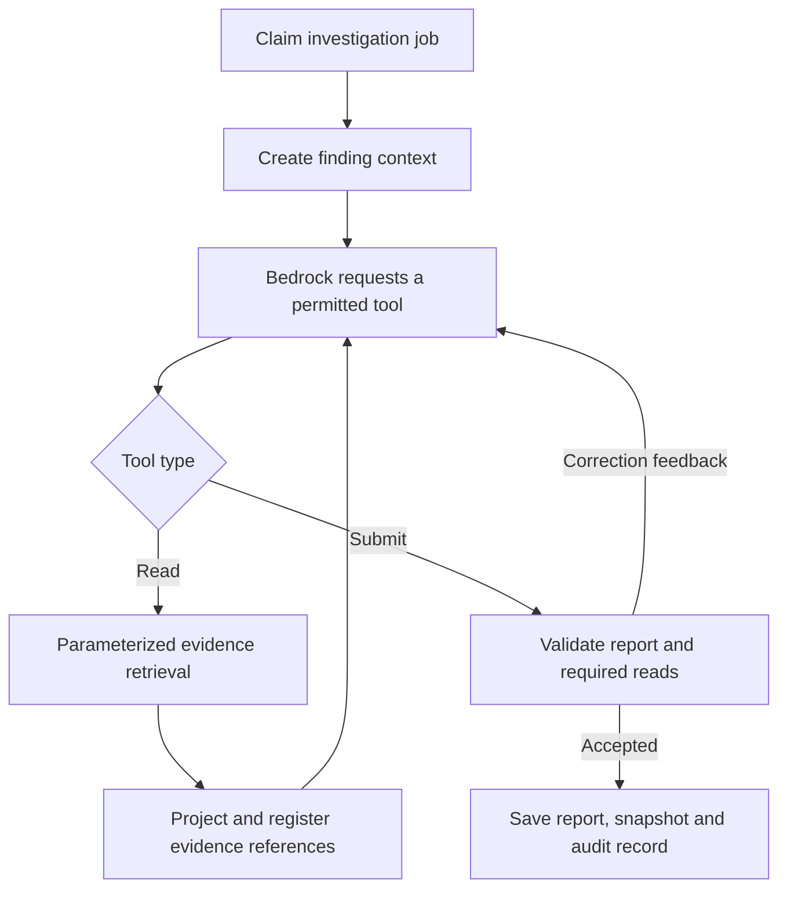
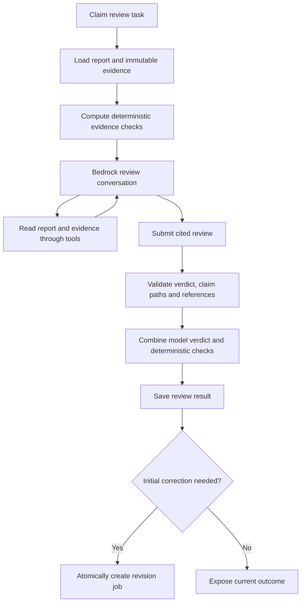
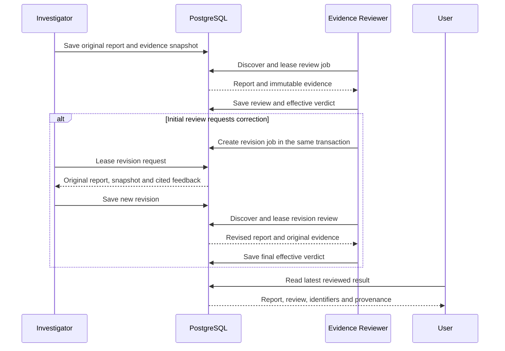
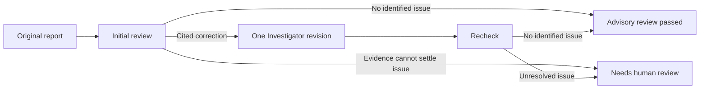

# Cooperative Agents for Evidence-Based AI Governance Auditing

## Agentic AI Course Project Report

| Document field | Value |
|---|---|
| Institution | RV College of Engineering |
| Course | Agentic AI |
| Team | Aditya Ranjan; Arindam Gupta; Gnanendra Naidu N |
| Project implementation | Complete |
| Report evidence sections | Captured agent figures and traces attached; final results consolidation and demo video pending |
| Document date | 3 November 2026 |
| Implementation reference | Repository source at commit `82c9910` |
| Document purpose | Master content for the Agentic AI report, presentation, project explanation and demonstration |

This report describes the implemented two-agent system and the governance pipeline that supplies its evidence. Its emphasis is agent roles, tool use, bounded autonomy, communication, memory, structured feedback and controlled revision. Final evaluation evidence and media have designated sections near the end.

## Contents

1. [Abstract](#1-abstract)
2. [Introduction and problem statement](#2-introduction-and-problem-statement)
3. [Objectives](#3-objectives)
4. [Agentic design and architecture](#4-agentic-design-and-architecture)
5. [Data and evidence environment](#5-data-and-evidence-environment)
6. [Investigator Agent](#6-investigator-agent)
7. [Evidence Reviewer Agent](#7-evidence-reviewer-agent)
8. [Agent communication protocol](#8-agent-communication-protocol)
9. [Reasoning and tool execution](#9-reasoning-and-tool-execution)
10. [Memory and evidence grounding](#10-memory-and-evidence-grounding)
11. [Feedback, revision and termination](#11-feedback-revision-and-termination)
12. [Illustrative interaction](#12-illustrative-interaction)
13. [Engineering and access controls](#13-engineering-and-access-controls)
14. [Runtime and configuration](#14-runtime-and-configuration)
15. [Testing and results](#15-testing-and-results)
16. [Pictures and demonstration video](#16-pictures-and-demonstration-video)
17. [Conclusion](#17-conclusion)
18. [Source references](#18-source-references)

## 1. Abstract

A governance finding identifies a policy condition, but a useful investigation must explain what happened and connect each factual claim to evidence. A second review role must be able to inspect that explanation, identify a specific disputed claim and communicate a correction without losing the original record.

This project implements two cooperating AI agents using Amazon Bedrock Converse and a custom Python tool-execution runtime. The Investigator Agent analyzes a persisted governance finding, retrieves its source event and configured rule, optionally gathers related events, and submits a structured report with evidence references. The Evidence Reviewer Agent reads the saved report and its immutable evidence snapshot, then returns an advisory review decision with cited issues and exact claim locations.

The agents communicate asynchronously through PostgreSQL jobs and saved results. A correction request can trigger one Investigator revision, which the reviewer checks again. Application code enforces the tool allowlists, evidence contracts, execution limits and stopping condition. Separate database roles govern each worker's access, while audit records retain model usage, tool activity and workflow transitions.

The underlying event pipeline normalizes five producer groups, evaluates 16 rules and persists scored findings. This gives the agents a structured evidence environment. The completed implementation demonstrates role specialization, model-directed tool selection, persistent task state and a bounded feedback loop in a concrete governance application.

**Keywords:** Agentic AI, cooperative agents, tool calling, evidence grounding, structured outputs, feedback, reflection, Amazon Bedrock, durable workflows, human review.

## 2. Introduction and problem statement

### 2.1 Application context

Governance events describe activity such as privileged access, infrastructure changes, model promotion and inference-policy signals. A rule engine can identify a configured condition, but an analyst also needs an explanation that identifies the relevant records, preserves event order and distinguishes supported observations from missing evidence.

The project assigns this explanation task to an Investigator Agent. A second agent reviews the result using the exact evidence available to the first. Their exchange is stored as a sequence of reports, feedback and revisions, making the collaboration visible to the user.

### 2.2 Problem statement

> How can two specialized agents investigate and review governance findings using bounded tools, traceable evidence and a controlled correction workflow?

The problem includes both reasoning and coordination. The reasoning task is to explain and review claims against evidence. The coordination task is to preserve each message, route it to the correct worker and stop the exchange at a defined outcome.

### 2.3 Implemented contribution

The system connects a deterministic governance finding to an agent-generated explanation and a separately prompted evidence review. Its communication contract records the report being reviewed, the claim requiring attention, the evidence supporting the objection and the returned revision. A reader can reconstruct the exchange from database records and audit events.

## 3. Objectives

1. Build an Investigator Agent that explains persisted findings using explicit evidence tools.
2. Build an Evidence Reviewer Agent with its own prompt, tools and database role.
3. Require structured submissions with valid evidence references and claim locations.
4. Route reports and feedback through durable, correlated PostgreSQL jobs.
5. Support one evidence-preserving revision and a final recheck.
6. Bound model turns, tool calls, context, time and retries.
7. Expose the original report, review, revision and current outcome for inspection.

## 4. Agentic design and architecture

### 4.1 Agentic concepts in the implementation

| Concept | Project implementation |
|---|---|
| Goal-directed task | Explain a finding or evaluate a saved explanation |
| Perception | Read structured finding data and evidence through tools |
| Tool selection | Bedrock selects permitted read/submission tools during a bounded conversation |
| Actions | Retrieve evidence, submit an investigation, submit a review or submit a revised report |
| Role specialization | Investigator produces an explanation; reviewer critiques its claims |
| Feedback | Reviewer identifies exact report paths and supplies cited corrections |
| Reflection through revision | Investigator reconsiders the report using the saved feedback and original evidence |
| Persistent memory | Jobs, snapshots, reports and audit records preserve case state |
| Human involvement | `needs_human_review` records the terminal handoff when evidence or review cannot settle a case |

The application defines the workflow and permission boundaries. Within a task, the model selects tools and composes the evidence-based submission. This division gives the model a bounded decision process while keeping routing and persistence explicit.

### 4.2 System architecture



The diagram shows two product agents. The Investigator's original-investigation and revision modes belong to the same agent role. The reviewer operates as a separate worker. Each role maintains its own Bedrock conversation, even when the configured model ID is the same.

### 4.3 Implementation modules

| Module | Responsibility |
|---|---|
| `agent.py` | Bedrock wrapper and shared bounded tool loop |
| `contracts.py` | Investigator tool definitions, report schema and validation |
| `store.py` | Original jobs, finding retrieval, projected evidence and result storage |
| `app.py` | Investigator command-line entry point and worker |
| `reviewer.py` | Reviewer prompt/tools and Investigator revision mode |
| `review_contracts.py` | Cited review schema, claim-path validation and deterministic checks |
| `review_store.py` | Durable review/revision task routing and persistence |
| `review_worker.py` | Executes either review or revision tasks |
| `reviewer_app.py` | Reviewer command-line entry point and worker |
| `settings.py` | Validated model, database and execution settings |

These files reside in `services/investigator-agent/`. The shared package allows both worker processes to use the same model client and execution controls while applying different role contracts.

**Source basis:** [A01], [A02], [A04], [A05], [A06], [A07].

## 5. Data and evidence environment

### 5.1 Governance evidence supply

Five independent adapters normalize events from Keycloak, Kubernetes audit, Airflow/OpenLineage, a model registry and an LLM gateway. Kafka Streams evaluates 16 rules. A separate scorer adds deterministic and Isolation Forest risk values, and a sink persists events and findings in PostgreSQL.

The rule catalog attaches the configured labels for NIST AI RMF, ISO/IEC 42001, EU AI Act, NIST SP 800-53 and GDPR. These labels provide the reporting context supplied by `get_rule`.

### 5.2 Data categories

| Data category | Contents | Agent use |
|---|---|---|
| Synthetic source events | Timestamped identity, infrastructure, pipeline, registry and gateway records | Reproducible evidence inputs |
| Persisted findings | Rule ID, source event ID, severity, scores and evidence | Investigation task context |
| Configured rule metadata | Title, description, severity and framework mappings | Explanation of the target finding |
| Projected events | Allowlisted identity/resource and governance fields | Model-visible event evidence |
| Investigation report | Summary, observations, timeline and evidence requirements | Reviewer input |
| Immutable snapshot | Exact retrieved evidence and pinned rule metadata | Common evidence for review and revision |
| Review feedback | Verdict, claim paths, evidence references and requested corrections | Investigator revision input |

### 5.3 Generation and eligibility

The evaluator creates labelled event scenarios and benign controls. Its HTTP mode sends source-shaped payloads through the real adapter endpoints. Ground-truth rule labels remain in evaluation storage, separate from the evidence tools used by the agents.

The default Investigator and reviewer rule selection is **GOV-002, GOV-003, GOV-004, GOV-006, GOV-011 and GOV-012**. These cover privileged access, privileged/unapproved workloads and production model promotion. Configuration can select known rule IDs from the existing catalog.

Related-event retrieval is limited to 20 records within 15 minutes before or after the source event. The query matches the environment and tenant marker, then selects the same model/version or, when no model key applies, the same eligible actor. The tool supplies the retrieval scope along with its returned evidence.

**Source basis:** [A03], [A08], [A10], [A11].

## 6. Investigator Agent

### 6.1 Purpose and inputs

The Investigator explains why a persisted finding exists and what the retrieved records support. Its initial context contains the finding and its task. The worker then supplies tools that retrieve the source event, related events and the finding's pinned rule metadata.

### 6.2 Internal architecture



### 6.3 Tools

| Tool | Input contract | Output | Purpose |
|---|---|---|---|
| `get_source_event` | Empty object; task fixes the source event | Projected source event and reference | Establish the triggering event |
| `get_rule` | Empty object; task fixes the rule | Configured metadata and policy-hash reference | Establish the rule context |
| `get_related_events` | Empty object; application fixes query scope | Bounded related events and scope information | Supply contextual evidence |
| `submit_investigation` | Structured report object | Validated report returned to the worker | Complete the task |

The empty read arguments are intentional. The worker determines the finding and query scope before the model acts. The Investigator must read the source event and rule before submission, and it submits separately from a batch of read calls.

### 6.4 Report contract

| Field | Meaning | Validation |
|---|---|---|
| `summary` | Main explanation | Text with evidence references |
| `observations` | Supporting factual statements | 1–12 cited observations |
| `timeline` | Recorded event sequence | Up to 20 items with retrieved `event:` references and exact timestamps |
| `missing_evidence` | Evidence needed to resolve remaining questions | Up to 8 text items |
| `recommended_next_steps` | Case-specific recommendations for a human reader | Up to 6 text items |
| `assessment` | Evidence-review state | `evidence_review_complete` or `needs_more_evidence` |

The schema rejects additional fields, unknown evidence references and mismatched timeline timestamps. Domain checks also validate specific authentication wording and the GOV-006 predicate description.

### 6.5 Saved outputs

`investigator.runs` retains the investigation and its evidence snapshot. `investigator.latest_reports` provides the latest successful original report for each finding. Audit entries retain tool activity, validated submission events, model token usage and attempt information.

**Source basis:** [A01], [A02], [A03], [A09].

## 7. Evidence Reviewer Agent

### 7.1 Purpose and inputs

The Evidence Reviewer evaluates the factual claims in a saved investigation. Its task is tied to that report's finding and rule. It receives the original run identifier and uses tools to retrieve the exact report and its evidence snapshot.

### 7.2 Internal architecture



### 7.3 Tools

| Tool | Returned or submitted material | Requirement |
|---|---|---|
| `get_report` | Saved report, original/revision IDs and exact editable claim paths | Required before review submission |
| `get_evidence` | Immutable evidence and its retrieval-scope description | Required before review submission |
| `submit_review` | Verdict, summary and cited issues | Submitted as a separate tool step |

### 7.4 Review issue contract

Each issue contains an exact JSON-pointer `claim_path`, a classification, an explanation, evidence references and a requested correction. Paths can address summary text, observation text, timeline descriptions, evidence requirements or case recommendations.

The issue classifications are:

| Code | Meaning |
|---|---|
| `contradiction` | A claim conflicts with cited evidence |
| `chronology` | Event ordering or temporal prose conflicts with timestamps |
| `unsupported_claim` | The cited evidence does not support the statement |
| `scope_overstatement` | A statement extends beyond the retrieved evidence scope |
| `invalid_citation` | A cited reference is inappropriate for the claim |

The validator requires that each path exist in the report and that each reference belong to the snapshot. A passing review has an empty issue list. A correction request has at least one cited issue.

### 7.5 Effective outcome

The application records the model's review and deterministic findings separately. The current deterministic checks address specific authentication and chronology statements. A deterministic issue can change a model pass into a correction request. If that request concerns an already revised report, the effective outcome becomes `needs_human_review`.

**Source basis:** [A04], [A05], [A06], [A07].

## 8. Agent communication protocol

### 8.1 Transport and routing

The agents communicate by writing and polling PostgreSQL records. Each message has a durable location and a run identifier. Database transactions connect a saved decision to its outgoing correction task.

| Message | Durable location | Writer | Reader |
|---|---|---|---|
| Original investigation and evidence | `investigator.runs` | Investigator | Reviewer |
| Review task | `reviewer.jobs` | Reviewer discovery logic | Reviewer worker |
| Review decision and cited feedback | `reviewer.runs` | Reviewer | Investigator revision worker and reporting |
| Correction request | `investigator.revision_jobs` | Review completion transaction | Investigator |
| Revised report | `investigator.revision_runs` | Investigator | Reviewer |
| Current reviewed result | `reviewer.latest_results` | Database view | CLI and reporting |

`source_run_id` identifies the original investigation throughout the exchange. `review_run_id` identifies the feedback requesting a correction. `revision_run_id` identifies the revised report being rechecked. Worker version and model identifiers identify the configuration associated with each job.

### 8.2 Message sequence



### 8.3 Message example

The following is a **schema illustration**, not a measured model output. The identifiers are placeholders replaced by actual snapshot references at runtime.

```json
{
  "verdict": "revision_required",
  "summary": "The report reverses the order of two recorded events.",
  "issues": [
    {
      "claim_path": "/observations/0/text",
      "code": "chronology",
      "explanation": "The login timestamp is later than the role-grant timestamp.",
      "evidence_refs": ["event:ROLE_EVENT_UUID", "event:LOGIN_EVENT_UUID"],
      "requested_correction": "Describe the login as occurring one second after the role grant."
    }
  ]
}
```

The application saves this review inside a result wrapper containing `deterministic_issues`, `effective_verdict` and `revision_limit_reached`. These fields show how application checks and the revision bound affected routing.

**Source basis:** [A05], [A06], [A09].

## 9. Reasoning and tool execution

### 9.1 Model interaction

The Bedrock wrapper sends the role's system instructions, conversation messages, tool specifications and output-token limit to `converse`. Bedrock returns a tool request. Python validates and executes that request, then sends the tool result back into the role's conversation.

A typical Investigator interaction reads the source event and rule, optionally reads contextual events, and then submits a report. A typical reviewer interaction reads the report and evidence and then submits its review. The model chooses its calls within the allowed interface, while code enforces required reads and valid submissions.

### 9.2 Bounded execution loop

1. Initialize the role's task message and start the task timer.
2. Check time and serialized conversation size.
3. Call Bedrock and record token-usage metadata.
4. Accept a tool-use response containing one to four tool calls.
5. Validate tool names, call IDs and JSON arguments.
6. Execute permitted reads and register returned evidence.
7. For a submission, verify required reads and validate the role's output contract.
8. Return validation feedback for correctable submission issues or save an accepted output.
9. Stop on a valid submission, execution limit or classified failure.

### 9.3 Execution constants

| Control | Implemented default or bound |
|---|---|
| Model turns per task | Default 6; configurable from 2 to 12 |
| Tool calls in one model response | 1–4 |
| Serialized conversation size | 100,000 characters |
| Logical task deadline | Default 120 seconds; configurable from 10 to 300 |
| Investigator output tokens per model call | Default 1,500 |
| Reviewer output tokens per model call | Default 3,000 |
| Task attempts | Default 3; configurable from 1 to 5 |
| Related events | At most 20, within a ±15-minute window |
| Revision count per review chain | At most one |

These are implementation settings. Final testing records the actual settings used in that run.

**Source basis:** [A01], [A08].

## 10. Memory and evidence grounding

### 10.1 Memory layers

| Memory layer | Representation | Lifetime and purpose |
|---|---|---|
| Task conversation | Role-specific message list | Supplies context during a single task |
| Retrieved evidence | Dictionary keyed by evidence reference | Grounds the task's structured submission |
| Evidence snapshot | Stored JSON attached to the original run | Fixes the evidence used during review and revision |
| Workflow state | Jobs, attempts, leases and run links | Preserves task progress across worker restarts |
| Case history | Original report, review and revised report | Preserves the visible collaboration |
| Audit history | Tool activity, usage, validation and lifecycle events | Supports execution inspection |

### 10.2 Evidence identifiers

The evidence map uses three reference families:

- `finding:<finding UUID>` identifies the finding context.
- `event:<event UUID>` identifies a retrieved event.
- `rule:<rule ID>:<policy SHA-256>` identifies pinned rule metadata.

The Investigator's summary and observations cite members of this map. Timeline entries use retrieved event references and their exact recorded timestamps. Reviewer issues cite the same snapshot and point to an existing report claim.

### 10.3 Data projection

The evidence tools project the source record into allowlisted governance fields before passing it to Bedrock. The model-visible context includes the identifiers, event times, relevant actor/subject information and rule-specific attributes needed for the task. The retrieval tool describes its bounded context so the report can qualify conclusions appropriately.

### 10.4 Revision evidence

`SnapshotTools` implements the Investigator's familiar read tools against the original stored evidence. This gives the original report, reviewer decision and revision a common evidential basis. A saved revision is a new report record with links to the original run and the review that requested it.

**Source basis:** [A02], [A03], [A04], [A09].

## 11. Feedback, revision and termination

### 11.1 Controlled reflection

The reviewer expresses feedback as a disputed claim, evidence and a requested correction. The Investigator's revision prompt asks it to reassess that feedback against the immutable snapshot and submit a complete report. Feedback enters the task as data to evaluate. It does not change the worker's tools or access rules.

This is the project's reflection mechanism: a separate role critiques the saved output, and the original role reconsiders the explanation while keeping the evidence fixed.

### 11.2 Workflow state



### 11.3 Meaning of the outcomes

| Outcome | Meaning in the application |
|---|---|
| `review_passed` | The review recorded no issues after application checks; the result remains advisory |
| `revision_required` | An initial review requests a cited correction |
| `needs_human_review` | The evidence cannot settle a material issue, or correction remains necessary after the allowed revision |
| Failed task | The worker could not complete a valid model/tool interaction within its execution and retry rules |

Review outcome and execution status are separate. A successfully executed task may produce a human-review outcome. A model/provider failure is recorded as a failed execution, retaining its error category and attempt history.

**Source basis:** [A04], [A05], [A06], [A07], [A09].

## 12. Illustrative interaction

This example explains the implemented communication contract. It is an **illustration**, not a final evaluation result.

1. A source record shows a privileged role grant at `17:35:06Z` without recorded change approval. The rule engine emits GOV-002 and the sink persists the finding.
2. The Investigator retrieves that event, GOV-002 metadata and a related successful login without MFA at `17:35:07Z`.
3. The Investigator submits a cited report. Suppose its prose incorrectly says the login preceded the role grant.
4. The reviewer reads the report and snapshot, identifies the affected observation path and cites the two timestamps in a chronology issue.
5. The review transaction stores the feedback and creates a revision request tied to the original run.
6. The Investigator reads the fixed snapshot and submits a report describing the login as one second after the role grant.
7. The application saves this as a new revision. The reviewer rechecks the complete revised report and records the effective outcome.
8. The user can inspect both report versions, the cited feedback and the audit history.

This example demonstrates task specialization, tool use, evidence grounding, structured agent communication and a bounded correction cycle. It also makes the difference between evidence timestamps and explanatory prose visible.

## 13. Engineering and access controls

### 13.1 Separate worker identities

The Investigator and reviewer use the `governance_investigator` and `governance_reviewer` database roles. The Investigator reads the domain records needed for its evidence tools. The reviewer reads saved reports and snapshots. Each role writes its own workflow records under the database permissions and triggers defined by the migrations.

### 13.2 Durable task execution

Workers claim jobs using `FOR UPDATE SKIP LOCKED` and a lease token. An expired or superseded worker cannot finalize a reclaimed job. Job uniqueness prevents repeated discovery from duplicating an existing task for the same configuration. Saving review feedback and its initial revision request happens in one database transaction.

### 13.3 Structured validation

Validation covers tool names, argument schemas, required reads, known evidence references, exact timeline timestamps, valid claim paths and compatible verdict/issue combinations. Invalid submissions receive structured feedback within the remaining task budget.

### 13.4 Bounded failure handling

Retryable failures receive bounded retries and backoff. Throttling delays the relevant worker. Configuration errors stop the affected worker with a visible failure code. Database problems preserve the lease-based recovery path. Audit records retain attempts, making execution history inspectable.

### 13.5 Traceability and reproducibility

Original jobs record finding identity, agent version, catalog hash and model ID. Review jobs also identify the reviewer configuration and target revision model. Saved snapshots, immutable result records and correlation IDs tie a model-generated statement to the material and configuration used to produce it.

The implementation includes scripted-model tests, provider-client stubs and real-PostgreSQL integration tests. These exercise the workflow and validation independently of model wording. Final empirical review quality is recorded separately in the testing/results section.

**Source basis:** [A02], [A03], [A05], [A06], [A07], [A09], [A12].

## 14. Runtime and configuration

### 14.1 Runtime components

The two workers share a Python image but have separate process entry points. `app.py worker` handles original investigations and, when enabled, queued revisions. `reviewer_app.py worker` handles original-report reviews and revision rechecks. Both call Bedrock through the shared client wrapper.

Docker Compose groups them under the `agents` profile and applies the additive database migrations before starting them. Model IDs, region and database identities are supplied through configuration. The project documents Amazon Nova 2 Lite through Bedrock as its exercised model configuration, while the worker reads its selected model/profile from the environment.

### 14.2 Configuration reference

| Setting | Purpose | Default or requirement |
|---|---|---|
| `AWS_REGION` | Bedrock region | Required for model calls |
| `BEDROCK_MODEL_ID` | Investigator model/profile | Required for investigation and revision calls |
| `REVIEWER_MODEL_ID` | Reviewer model/profile | Required in host mode; Compose falls back to the Investigator model |
| `INVESTIGATOR_POSTGRES_DSN` | Investigator database connection | Required in host mode |
| `REVIEWER_POSTGRES_DSN` | Reviewer database connection | Required in host mode |
| `INVESTIGATOR_RULES_PATH` | Rule-catalog file | Repository/container `config/rules.yml` |
| `INVESTIGATOR_RULE_IDS`, `REVIEWER_RULE_IDS` | Eligible rule selection | GOV-002,003,004,006,011,012 |
| `INVESTIGATOR_REVISIONS_ENABLED` | Allow Investigator to process correction tasks | Host default false; Compose profile enables revisions |
| `*_POLL_SECONDS` | Task polling interval | 5 seconds |
| `*_MAX_STEPS` | Model-turn budget | 6 |
| `*_MAX_ATTEMPTS` | Task attempt limit | 3 |
| `*_TIMEOUT_SECONDS` | Logical task deadline | 120 seconds |
| `INVESTIGATOR_MAX_TOKENS` | Per-call output bound | 1,500 |
| `REVIEWER_MAX_TOKENS` | Per-call output bound | 3,000 |

The `*` prefixes are `INVESTIGATOR` and `REVIEWER`. AWS credentials are supplied by the configured credential chain or the temporary credentials forwarded to containers. Revision jobs record a target model ID, and the Investigator claims revisions that match its configured model.

### 14.3 Operational interfaces

| Interface | Function |
|---|---|
| `app.py investigate FINDING_UUID` | Investigate one selected eligible finding |
| `app.py once` / `worker` | Process one original task / run the worker loop |
| `app.py revise-once` | Process one available revision task |
| `reviewer_app.py review ORIGINAL_RUN_UUID` | Process a review for the specified original chain |
| `reviewer_app.py worker` | Discover and process reviews and rechecks |
| `app.py show` / `status` | Inspect original investigations and jobs |
| `reviewer_app.py show` / `status` | Inspect reviewed results and review jobs |

The reporting utilities export original investigations and two-agent traces to standalone HTML with associated JSON evidence.

**Source basis:** [A01], [A06], [A07], [A08], [A10], [A13].

## 15. Testing and results

> **Evidence section pending:** Insert final test execution details, measured workflow results, review-quality analysis and supporting figures here. The following structure distinguishes successful execution from the quality of the agents' judgments.

### 15.1 Test coverage to document

| Test group | Evidence to include |
|---|---|
| Investigator tools | Required reads, scoped retrieval, valid references and report schema |
| Reviewer tools | Report/evidence reads, claim-path validation and cited corrections |
| Two-agent exchange | Original investigation, review, revision and recheck |
| Persistence | Atomic feedback routing, original preservation and result visibility |
| Worker coordination | Duplicate discovery, stale leases and restart behavior |
| Execution bounds | Tool, turn, context, timeout and retry limits |
| Database roles | Permitted reads/writes and denied mutations |
| Semantic review | Whether challenged claims and requested corrections agree with evidence |

### 15.2 Evaluation material

The review evaluation utility combines saved problem reports with constructed factual controls. Its labels and inspection notes belong to evaluation data. The agents receive the report and snapshot needed for their task. Final results identify the corpus composition, model IDs, settings and immutable evidence used for comparison.

### 15.3 Final result table

| Item | Final value |
|---|---|
| Run date, source commit and environment | Pending final evidence |
| Investigator/reviewer model IDs and settings | Pending final evidence |
| Corpus size and composition | Pending final evidence |
| Original investigations completed | Pending final evidence |
| Initial reviews, revisions and rechecks completed | Pending final evidence |
| Known-problem reports correctly challenged | Pending final evidence |
| Clean reports correctly passed | Pending final evidence |
| Correctness of requested corrections | Pending final evidence |
| Final advisory/human-review outcomes | Pending final evidence |
| Original and snapshot preservation | Pending final evidence |
| Model calls, tokens and task duration | Pending final evidence |
| Automated test summary | Pending final evidence |

A challenge counts as a correct diagnosis only when its cited objection agrees with the evidence. A completed review job records execution success; report correctness is assessed separately. Final qualitative examples include the original claim, evidence, feedback, revision and final outcome.

### 15.4 Captured demonstration evidence - 3 November 2026

One fresh synthetic privileged-login event completed the live Investigator and Evidence Reviewer flow. The Investigator made **two Bedrock calls** and the reviewer made **three**. The saved review returned `review_passed` with zero issues, requested no revision and preserved the original report/evidence. The application audit recorded **12,436 input tokens and 530 output tokens**; CloudWatch returned the same totals and **five successful invocations** for the selected model/window. This is a traced single-case demonstration, separate from corpus-wide semantic-quality evaluation.

The automated agent suite passed **83 tests in 9.65 seconds** against an isolated PostgreSQL test database. A separately labelled saved **2 November** example shows the correction path: cited feedback, one revision and a recheck ending in `needs_human_review`.

Use the [evidence index and captions](evidence/2026-11-03/README.md), [full live trace](evidence/2026-11-03/traces/live-agent-trace.json), [tool trace CSV](evidence/2026-11-03/traces/live-tool-trace.csv), [saved correction trace](evidence/2026-11-03/traces/saved-correction-trace.json) and [AWS metric data](evidence/2026-11-03/traces/aws-bedrock-live-metrics.json) for verification. Local figures are labelled offline renderings of actual records; AWS charts are direct CloudWatch exports.

## 16. Pictures and demonstration video

### 16.1 Picture slots

| Figure | Required picture | Caption content | Status |
|---|---|---|---|
| AAI-F01 | Two-agent architecture | Roles, evidence storage, Bedrock and feedback path | Mermaid diagram in Section 4.2 |
| AAI-F02 | Finding and evidence | Source event, GOV-003 and persisted scores | [Captured figure](evidence/2026-11-03/figures/04-persisted-finding.png) |
| AAI-F03 | Investigator tool trace | Required reads and structured submission | [Captured figure](evidence/2026-11-03/figures/05-agent-tool-trace.png) |
| AAI-F04 | Original report | Cited summary, observations, timeline and review | [Captured figure](evidence/2026-11-03/figures/06-reviewed-report.png) |
| AAI-F05 | Reviewer feedback | Actual cited chronology feedback from the saved 2 November case | [Captured figure](evidence/2026-11-03/figures/07-correction-and-recheck.png) |
| AAI-F06 | Revision and recheck | One revision and final human-review outcome in the saved case | [Captured figure](evidence/2026-11-03/figures/07-correction-and-recheck.png) |
| AAI-F07 | Workflow/audit history | Timestamped tool/model activity and original-run identity | [Captured figure](evidence/2026-11-03/figures/05-agent-tool-trace.png) and [full trace](evidence/2026-11-03/traces/live-agent-trace.json) |
| AAI-F08 | Test execution | Fresh 83-test run and consumer checks | [Captured figure](evidence/2026-11-03/figures/08-tests-and-consumer-checks.png) |
| AAI-F09 | Live provider metrics | CloudWatch invocation, token and latency metrics | [Invocations](evidence/2026-11-03/screenshots/09-aws-bedrock-invocations.png), [tokens](evidence/2026-11-03/screenshots/10-aws-bedrock-tokens.png), [latency](evidence/2026-11-03/screenshots/11-aws-bedrock-latency.png) |

### 16.2 Demo video

**Video file or link:** Pending insertion.

The demonstration introduces the two roles, selects a stored finding, shows the Investigator's evidence calls, opens its structured report, follows the reviewer's cited feedback, displays the resulting revision and recheck, and finishes with the final testing/results evidence. The narration follows one `source_run_id` to show exactly how the agents communicate.

## 17. Conclusion

The project implements two cooperating agents around a traceable governance evidence store. The Investigator produces a structured explanation, and the Evidence Reviewer evaluates its claims through a separate role and conversation. Durable PostgreSQL messages connect their work, while schema validation, evidence references and a one-revision bound make the interaction inspectable. The completed implementation demonstrates tool-based reasoning, role specialization, persistent case memory and controlled reflection within an operational application workflow.

## 18. Source references

Paths are relative to the repository. Line references describe the implementation snapshot used for this report.

| ID | Source | Relevant entry point |
|---|---|---|
| A01 | [agent.py](../services/investigator-agent/agent.py) | Bedrock client at line 43; shared loop at line 123 |
| A02 | [contracts.py](../services/investigator-agent/contracts.py) | Report/tool schemas; report validation at line 84 |
| A03 | [store.py](../services/investigator-agent/store.py) | Job store at line 44; scoped query at line 207; projection at line 295; evidence tools at line 336 |
| A04 | [reviewer.py](../services/investigator-agent/reviewer.py) | Review prompt at line 9; tools at line 50; reviewer at line 74; snapshot tools at line 97; revision role at line 134 |
| A05 | [review_contracts.py](../services/investigator-agent/review_contracts.py) | Claim paths at line 57; validation at line 69; deterministic checks at line 110; effective outcome at line 165 |
| A06 | [review_store.py](../services/investigator-agent/review_store.py) | Discovery at line 51; leases at line 126; completion/routing at line 202 |
| A07 | [review_worker.py](../services/investigator-agent/review_worker.py), [Investigator CLI](../services/investigator-agent/app.py), [reviewer CLI](../services/investigator-agent/reviewer_app.py) | Task dispatch at line 27; CLI entry points at lines 47 and 19 |
| A08 | [settings.py](../services/investigator-agent/settings.py), [docker-compose.yml](../docker-compose.yml) | Defaults at line 19; validated settings at line 32; worker configuration at Compose lines 167 and 191 |
| A09 | [002_investigator.sql](../db/002_investigator.sql), [003_reviewer.sql](../db/003_reviewer.sql) | Original/review/revision tables, role permissions, triggers and result views |
| A10 | [Investigator documentation](investigator-agent.md), [reviewer documentation](reviewer-agent.md) | Configuration, communication contract and execution semantics |
| A11 | [Evaluator](../evaluation/evaluator.py), [rule catalog](../config/rules.yml), [event schema](../schemas/governance-event.schema.json) | Scenario generation at line 93; ingestion at line 134; evidence inputs |
| A12 | [Agent test suite](../services/investigator-agent/tests), [CI workflow](../.github/workflows/investigator.yml) | Scripted models, database integration and build checks |
| A13 | [Investigation export](../evaluation/export_e2e_report.py), [review evaluation/export](../evaluation/reviewer_evaluation.py) | Report generation and review evaluation utilities |

The diagrams and illustrative interaction explain the implemented control flow. Configuration values describe execution behavior; measured outcomes belong in Section 15.
