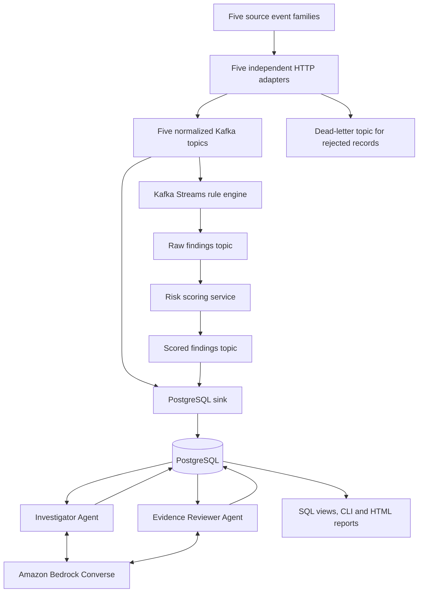
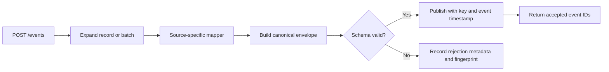
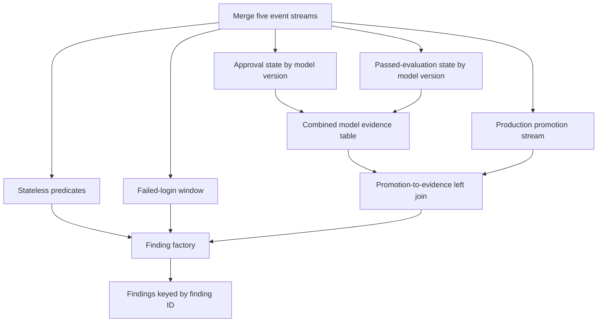

# Real-Time AI Governance Audit Pipeline

## SPA Course Project Report

| Document field | Value |
|---|---|
| Institution | RV College of Engineering |
| Course | SPA |
| Team | Aditya Ranjan; Arindam Gupta; Gnanendra Naidu N |
| Project implementation | Complete |
| Report evidence sections | Captured flow figures and traces attached; final results consolidation and demo video pending |
| Document date | 3 November 2026 |
| Implementation reference | Repository source at commit `82c9910` |
| Document purpose | Master content for the SPA report, presentation, project explanation and demonstration |

This report describes the implemented system. Its emphasis is the software architecture, event processing, data contracts, rule evaluation, risk scoring, persistence and integration of the two agents. Numerical evaluation results and media have designated sections near the end.

## Contents

1. [Abstract](#1-abstract)
2. [Introduction and problem statement](#2-introduction-and-problem-statement)
3. [Objectives](#3-objectives)
4. [System architecture](#4-system-architecture)
5. [Data sources and generation](#5-data-sources-and-generation)
6. [Data contracts and streaming](#6-data-contracts-and-streaming)
7. [Rule engine and framework mapping](#7-rule-engine-and-framework-mapping)
8. [Risk scoring](#8-risk-scoring)
9. [Database and reporting](#9-database-and-reporting)
10. [Agent integration](#10-agent-integration)
11. [Runtime operation and configuration](#11-runtime-operation-and-configuration)
12. [Engineering design](#12-engineering-design)
13. [Testing and results](#13-testing-and-results)
14. [Pictures and demonstration video](#14-pictures-and-demonstration-video)
15. [Conclusion](#15-conclusion)
16. [Source references](#16-source-references)

## 1. Abstract

AI governance evidence is distributed across identity systems, infrastructure, data pipelines, model registries and inference gateways. Understanding a governance incident requires a consistent representation of these events, explicit policy checks and a traceable connection between a finding and its source evidence.

This project implements a real-time governance audit pipeline using five independent producer adapters, Kafka-compatible event streaming, a Java Kafka Streams rule engine, a Python risk scorer and PostgreSQL storage. The adapters transform source-specific messages into a shared JSON event contract. The rule engine evaluates 16 configured governance controls through stateless predicates, an event-time window and model-version state joins. Each finding includes its source event, severity, evidence and mappings to five governance framework labels in the project catalog. A separate scoring service stores both a deterministic risk score and an Isolation Forest score.

Two Amazon Bedrock-powered agents operate on the persisted findings. The Investigator prepares a structured explanation with evidence references. The Evidence Reviewer checks its claims against the saved evidence and can request one revision. PostgreSQL jobs carry their reports and feedback, preserving the original investigation and the review history.

The completed implementation brings event ingestion, policy evaluation, risk prioritization and evidence-based investigation into one traceable workflow. SQL views, command-line interfaces and standalone HTML reports expose the resulting records for analysis and presentation.

**Keywords:** software architecture, event streaming, Kafka Streams, AI governance, policy evaluation, Isolation Forest, PostgreSQL, Amazon Bedrock, cooperative agents.

## 2. Introduction and problem statement

### 2.1 Application context

A model deployment involves several systems. An identity service records who signed in or received a privileged role. Kubernetes records infrastructure activity. Pipeline tools record dataset use and evaluation events. A registry records model lifecycle changes. An LLM gateway records inference-related policy signals.

These records use different fields and arrive independently. A source event becomes useful audit evidence only after the system identifies its actor, affected resource, time, policy relevance and relationship to other records.

### 2.2 Problem statement

The project addresses the following problem:

> How can events from multiple AI-related systems be transformed into traceable governance findings, prioritized consistently and explained using their recorded evidence?

The architectural requirements are consistent event contracts, independent service boundaries, stateful processing where needed, durable storage and a reproducible path from an input event to a reviewed explanation.

### 2.3 Project contribution

The implementation provides an integrated event-to-evidence workflow. Its central contribution is the connection between source normalization, executable governance rules, comparative risk scores and a two-agent review process. Stable identifiers connect each stage, allowing a reader to follow a finding back to the event that triggered it and forward to its investigation and review.

## 3. Objectives

1. Normalize five producer groups into a common governance event schema.
2. Stream normalized events through separate source topics.
3. Evaluate 16 governance rules, including time-window and state-join conditions.
4. Attach configured framework mappings and supporting evidence to each finding.
5. Compute deterministic and Isolation Forest risk scores.
6. Persist events, findings, investigations and review history in PostgreSQL.
7. Integrate an Investigator and an Evidence Reviewer through durable jobs.
8. Provide reporting views and reproducible evaluation utilities.

## 4. System architecture

### 4.1 High-level architecture



The core processing path has eight application services: five adapters, one rule engine, one scorer and one sink. Two additional worker services provide investigation and review. Kafka and PostgreSQL supply messaging and storage infrastructure.

### 4.2 Module responsibilities

| Module | Purpose | Input | Output | Main dependency |
|---|---|---|---|---|
| Producer adapters | Normalize source records and validate their envelopes | HTTP event payloads | Canonical events or dead-letter metadata | JSON Schema and Kafka producer |
| Kafka topics | Carry records between independently running services | Events and findings | Partitioned record streams | Local broker or configured MSK connection |
| Rule engine | Detect configured governance conditions | Five canonical event streams | Raw compliance findings | Kafka Streams and rule catalog |
| Risk scorer | Prioritize findings using two scoring methods | Raw findings | Scored findings | scikit-learn and Kafka clients |
| Database sink | Persist business records | Canonical events and scored findings | PostgreSQL rows | Kafka consumer and psycopg |
| Investigator | Explain a finding using retrieved evidence | Persisted finding and scoped evidence | Cited investigation report | Bedrock and PostgreSQL |
| Evidence Reviewer | Check report claims and issue feedback | Saved report and evidence snapshot | Review decision and correction request | Bedrock and PostgreSQL |
| Reporting layer | Expose findings and review history | Stored records | SQL views, CLI output and HTML reports | PostgreSQL and export utilities |

### 4.3 Deployment artifacts

Docker Compose defines the local application stack, using Redpanda as the Kafka-compatible broker and a PostgreSQL container. The repository also contains Terraform definitions for VPC networking, Amazon MSK, EKS, RDS PostgreSQL and ECR, together with Kubernetes workload manifests. These files describe the infrastructure configuration and application deployment structure. The agent workers call Amazon Bedrock through its Converse API.

**Source basis:** [S01], [S04], [S07], [S09], [S13], [S15].

## 5. Data sources and generation

### 5.1 Producer groups

The project uses a generated governance-event corpus with source-specific payloads. The five producer groups represent the systems from which audit evidence is collected.

| Producer group | Representative events | Governance information |
|---|---|---|
| Keycloak | Login failure, successful login, role grant | Authentication, MFA and privileged access |
| Kubernetes audit | Cluster-role binding, secret access, pod creation | Infrastructure privileges and workload configuration |
| Airflow/OpenLineage | Dataset read, schema change, drift evaluation, bias evaluation, completed model evaluation | Data ownership, schema control and evaluation evidence |
| Model registry | Approval, production promotion, artifact registration | Model release approval and artifact integrity |
| LLM gateway | Prompt request with policy signals | PII handling, model authorization and injection/exfiltration indicators |

Drift, bias and gateway detection values are inputs to governance checks. For example, the pipeline compares a supplied drift metric against its supplied threshold, and the gateway rule consumes a supplied injection score.

### 5.2 Synthetic corpus construction

`evaluation/evaluator.py` constructs timestamped source events and records their expected rule matches. Each generated event contains a UUID, source identity, actor, subject, event type, environment and policy attributes. Synthetic records carry a `synthetic` label.

The base scenario generator creates **24 events and 16 expected event-rule pairs per repetition**, including five benign control events. These are properties of the generator, not measured test results. Repetition-specific identities and model versions distinguish the generated cases.

Two ingestion modes are implemented:

1. **HTTP adapter mode:** source-shaped payloads are posted to the five `/events` endpoints. The evaluator checks the returned event identifiers.
2. **Direct Kafka mode:** canonical envelopes are published directly to their source topics for processing-focused evaluation.

The evaluator writes expected `(event_id, rule_id)` pairs to `evaluation_ground_truth`. It also records the input event membership and run identifier, keeping generated expectations separate from observed findings.

### 5.3 Data used by the learning and reasoning components

| Component | Data used | How it is used |
|---|---|---|
| Rule engine | Canonical governance events | Evaluates explicit conditions |
| Isolation Forest | Numeric and categorical features derived from findings | Fits an online anomaly-scoring model |
| Investigator | A finding, projected source event, rule metadata and scoped related events | Supplies evidence to a pretrained Bedrock model |
| Evidence Reviewer | Saved report and immutable evidence snapshot | Supplies the material for a separate model review |

**Source basis:** [S02], [S03], [S08], [S14].

## 6. Data contracts and streaming

### 6.1 Canonical event contract

`GovernanceEvent v1` is the shared contract between ingestion, processing and persistence.

| Field group | Principal fields | Purpose |
|---|---|---|
| Identity | `schema_version`, `event_id`, `correlation_id`, optional `trace_id` | Versioning and record traceability |
| Time | `event_time`, `ingested_at` | Event-time processing and latency measurement |
| Classification | `producer`, `event_type`, `action`, `outcome`, `environment` | Routing and rule selection |
| Actor | `actor.id`, `type`, `roles`, optional namespace/IP | Identifies the acting identity |
| Subject | Resource ID/type, namespace, model name/version, classification | Identifies the affected entity |
| Policy data | `attributes`, `labels` | Carries rule-specific values and record labels |

Adapters validate the envelope using JSON Schema. When a source supplies an identifier, normalization creates a deterministic canonical event ID from that identifier and producer. The adapter's HTTP acknowledgement returns the accepted IDs.

### 6.2 Adapter internals



The shared runtime owns request handling, size limits, validation, publishing, health checks and counters. Each source-specific mapper owns the translation of its payload. The LLM gateway mapper carries policy signals and a prompt fingerprint into the canonical record.

### 6.3 Topic contracts

| Topic | Producer | Consumer |
|---|---|---|
| `governance.keycloak.v1` | Keycloak adapter | Rule engine and sink |
| `governance.kubernetes.v1` | Kubernetes adapter | Rule engine and sink |
| `governance.pipeline.v1` | Airflow/OpenLineage adapter | Rule engine and sink |
| `governance.model-registry.v1` | Model registry adapter | Rule engine and sink |
| `governance.llm-gateway.v1` | LLM gateway adapter | Rule engine and sink |
| `governance.findings.raw.v1` | Rule engine | Risk scorer |
| `governance.findings.scored.v1` | Risk scorer | Sink |
| `governance.dead-letter.v1` | Adapters | Rejection inspection |

Actor IDs support identity-based processing. Model-related records use a model-name/version key. The topology explicitly selects the keys needed by its windows and joins.

**Source basis:** [S02], [S03], [S04], [S10].

## 7. Rule engine and framework mapping

### 7.1 Internal architecture



Rule metadata and framework mappings reside in `config/rules.yml`. Executable single-event predicates reside in `StatelessRuleEngine.java`. The Kafka Streams topology implements the window and join conditions.

### 7.2 Implemented rule catalog

| ID | Governance condition | Processing type | Severity |
|---|---|---|---|
| GOV-001 | Fifth failed login for one identity within a five-minute window | Event-time window | 4 / high |
| GOV-002 | Privileged role grant without recorded change approval | Stateless | 5 / critical |
| GOV-003 | Privileged successful login without MFA | Stateless | 4 / high |
| GOV-004 | Cluster-admin binding without recorded change approval | Stateless | 5 / critical |
| GOV-005 | Cross-namespace secret access | Stateless | 5 / critical |
| GOV-006 | Privileged pod or pod using an unapproved image | Stateless | 4 / high |
| GOV-007 | Dataset read with no declared owner | Stateless | 3 / medium |
| GOV-008 | Schema change without a version increment | Stateless | 4 / high |
| GOV-009 | Drift above threshold while remediation status is not `STARTED` | Stateless | 4 / high |
| GOV-010 | Bias above threshold without an approved exception | Stateless | 5 / critical |
| GOV-011 | Production promotion without approval state | Stream-table join | 5 / critical |
| GOV-012 | Production promotion without passed-evaluation state | Stream-table join | 5 / critical |
| GOV-013 | Artifact registration without a verified signature or with a missing digest | Stateless | 4 / high |
| GOV-014 | PII signal in a prompt without an allowed handling path | Stateless | 5 / critical |
| GOV-015 | Invocation of a model marked unapproved | Stateless | 4 / high |
| GOV-016 | Injection score at least 0.8 or an exfiltration signal | Stateless | 5 / critical |

GOV-001 uses a five-minute tumbling event-time window and one minute of grace. The topology emits its finding when the count first reaches five. GOV-011 and GOV-012 join a production promotion to approval and passed-evaluation state for the same immutable model version. A single event can generate more than one finding.

### 7.3 Framework labels

Each catalog entry carries mappings to the following configured frameworks:

| Catalog key | Framework label |
|---|---|
| `NIST_AI_RMF` | NIST AI Risk Management Framework 1.0 |
| `ISO_IEC_42001` | ISO/IEC 42001:2023 |
| `EU_AI_ACT` | EU AI Act |
| `NIST_SP_800_53` | NIST SP 800-53 Rev. 5 |
| `GDPR` | General Data Protection Regulation |

These mappings classify the relevance of a finding for reporting. For example, the repository maps GOV-003 to NIST SP 800-53 `IA-2` and `AC-6`, among its other configured labels. A framework view counts relevant evidence and findings; its values describe the recorded technical findings.

### 7.4 Finding record

A finding contains a stable finding ID, rule ID, title, producer, source event ID/time, detection time, severity, frequency, baseline risk, framework mappings and evidence. Window findings additionally include their time boundaries. The scored version adds the model score, score difference, recommended risk and model readiness status.

**Source basis:** [S04], [S05], [S06], [S10].

## 8. Risk scoring

### 8.1 Deterministic baseline

The baseline calculation is:

```text
baseline_risk = bounded_severity × frequency_band × 4
```

Severity is bounded to 1–5. Frequency bands are defined as follows:

| Occurrence count | Band |
|---|---:|
| 1 | 1 |
| 2–3 | 2 |
| 4–7 | 3 |
| 8–15 | 4 |
| 16 or more | 5 |

The calculation produces values within 0–100. The occurrence count belongs to the emitted finding. Single-event and promotion findings use frequency 1; the login-burst finding uses the threshold count 5. For illustration, severity 4 and frequency 5 produce `4 × 3 × 4 = 48`. This arithmetic example explains the code and is not an evaluation result.

### 8.2 Isolation Forest

The scorer converts each finding to 26 features: five numeric/time features, 16 one-hot rule features and five one-hot producer features. The numeric features include normalized severity, frequency band, baseline score and sine/cosine encodings of the source event's hour.

The implementation uses a bounded history of 1,000 findings, begins fitting after 32 findings, and refits after every 25 additional findings. It configures 200 trees and a fixed random seed. The score transformation is:

```text
isolation_forest_risk = clip(50 - 100 × decision_function, 0, 100)
risk_delta = isolation_forest_risk - baseline_risk
recommended_risk = max(baseline_risk, isolation_forest_risk)
```

During warm-up, the ML score and difference are null and the recommended score is the baseline. `model_status` distinguishes warm-up from the ready state. PostgreSQL retains both scores so reporting can compare them directly.

**Source basis:** [S06], [S08].

## 9. Database and reporting

### 9.1 Storage model

| Table or schema | Stored information |
|---|---|
| `raw_events` | Canonical events, source timestamps and JSONB payloads |
| `compliance_findings` | Rule hits, severity, both scores, mappings and evidence |
| `evaluation_runs` | Evaluation-run metadata and computed result objects |
| `evaluation_events` | Input-event membership for each evaluation run |
| `evaluation_ground_truth` | Expected event-rule matches |
| `investigator` schema | Original jobs, investigations, evidence snapshots, revisions and audit records |
| `reviewer` schema | Review jobs, review decisions, audit records and current reviewed results |

The sink uses `ON CONFLICT` handling for repeat writes. Raw-event conflicts preserve the stored event. Finding conflicts update score-related fields. The sink commits a database write before acknowledging its Kafka offset.

### 9.2 Reporting interfaces

| View or interface | Purpose |
|---|---|
| `finding_framework_controls` | Expands finding mappings into framework/control rows |
| `tableau_framework_status` | Daily framework totals and risk aggregates |
| `tableau_risk_trend` | Five-minute baseline, ML and recommended-risk aggregates |
| `tableau_incident_history` | Finding-level inspection with evidence |
| `tableau_pipeline_latency` | Persistence-latency percentiles by producer and time bucket |
| `investigator.latest_reports` | Latest successful original investigations |
| `reviewer.latest_results` | Current original/revised report with its review result |
| CLI and HTML exports | Inspect jobs, reports, feedback, revisions and evidence |

**Source basis:** [S09], [S11], [S12], [S13].

## 10. Agent integration

The Investigator and Evidence Reviewer extend the persisted-evidence layer. They run as separate Python workers and use separate Bedrock conversations.

1. The Investigator discovers an eligible stored finding and leases a job.
2. It retrieves the source event and the finding's rule metadata, and can retrieve scoped related events.
3. It submits a structured report containing cited observations, a timeline and evidence requirements.
4. The system saves the report and its evidence snapshot.
5. The reviewer leases a review task and reads that saved report and snapshot.
6. It saves a cited review decision. An initial correction decision creates a revision job.
7. The Investigator writes one complete revision using the original evidence.
8. The reviewer checks the revision and records the final advisory outcome or human-review outcome.

The agents communicate through PostgreSQL records keyed by the original `source_run_id`. The `review_run_id` identifies the feedback, and the `revision_run_id` identifies the returned report. The first review and its correction request are saved atomically. Original reports and snapshots remain available throughout the exchange.

This integration connects an explicit rule finding to a readable explanation and a separately prompted evidence review. The application controls access, validates submissions and enforces the one-revision stopping condition.

**Source basis:** [S12], [S13].

## 11. Runtime operation and configuration

### 11.1 Startup and data flow

1. Docker Compose starts the broker and PostgreSQL. Topic initialization establishes the messaging contracts, and database initialization supplies the schemas.
2. Five adapters start their HTTP endpoints and health checks.
3. The rule processor loads the catalog and starts its Kafka Streams topology.
4. The scorer and sink join their consumer groups and begin reading their input topics.
5. Source events or generated fixtures enter the adapters and reach the processing pipeline.
6. Findings receive scores and are persisted alongside the source events.
7. The `agents` profile applies the additive agent migrations and starts the two configured workers.
8. Users inspect database views, CLI results and exported reports.

### 11.2 Local endpoints

| Service | Local event endpoint |
|---|---|
| Keycloak | `http://localhost:8101/events` |
| Kubernetes audit | `http://localhost:8102/events` |
| Airflow/OpenLineage | `http://localhost:8103/events` |
| Model registry | `http://localhost:8104/events` |
| LLM gateway | `http://localhost:8105/events` |

Each adapter also exposes `/healthz`, `/readyz` and `/metrics`.

### 11.3 Configuration groups

| Group | Key settings | Role |
|---|---|---|
| Broker | `KAFKA_BOOTSTRAP_SERVERS`, `KAFKA_SECURITY_PROTOCOL` | Broker address and transport |
| Stream processor | `KAFKA_APPLICATION_ID`, `KAFKA_STREAM_THREADS`, `KAFKA_STATE_DIR`, `KAFKA_INTERNAL_REPLICATION_FACTOR` | Application identity and processing state |
| Storage | `POSTGRES_DSN` | Sink/evaluator database connection |
| ML scorer | `RISK_MODEL_MIN_SAMPLES`, `RISK_MODEL_RETRAIN_EVERY`, `RISK_MODEL_HISTORY_SIZE` | Fit schedule and history bound |
| Bedrock | `AWS_REGION`, `BEDROCK_MODEL_ID`, `REVIEWER_MODEL_ID` | Provider region and per-role model selection |
| Agent storage | `INVESTIGATOR_POSTGRES_DSN`, `REVIEWER_POSTGRES_DSN` | Worker database identities |
| Agent execution | `*_RULE_IDS`, `*_POLL_SECONDS`, `*_MAX_STEPS`, `*_MAX_ATTEMPTS`, `*_TIMEOUT_SECONDS`, `*_MAX_TOKENS` | Selection and execution limits |

The `*` prefixes above are `INVESTIGATOR` and `REVIEWER`. Defaults and valid ranges are defined in the implementation; Compose forwards its listed variables to the relevant services. Credentials are supplied through the runtime environment or configured AWS credential chain.

**Source basis:** [S01], [S07], [S08], [S12], [S15].

## 12. Engineering design

### 12.1 Separation of responsibilities

Normalization, policy evaluation, scoring, persistence and agent reasoning each have a dedicated component. Shared adapter code handles protocol concerns while source mappers handle field translation. The rule catalog separates reportable metadata from executable predicates.

### 12.2 Message and record identity

Event IDs connect source records to findings. Finding IDs identify persisted rule outcomes. Model name/version keys align approval and evaluation records with promotions. Agent job identities include implementation/model configuration so rediscovery can reuse existing work. Review and revision IDs preserve the conversation chain.

### 12.3 Processing and recovery controls

Kafka Streams is configured with `exactly_once_v2` for its own topology processing. Database writes use explicit transactions and conflict handling. Agent queues use `FOR UPDATE SKIP LOCKED`, lease tokens and bounded attempts. A worker must still own its lease when it saves a result.

### 12.4 Evidence handling

Adapters retain rejection metadata and a payload fingerprint for invalid input. Agent tools use parameterized queries and allowlisted projections. Reports carry exact evidence references and event timestamps. Reviewer feedback names the report claim it concerns, allowing each correction to be traced to a specific statement.

### 12.5 Development structure

The repository includes Java rule/topology tests, Python mapper/scorer tests, database-backed agent tests, Docker build definitions and an agent CI workflow. Git branches keep implementation work separate, and report source references identify the code used to prepare this document.

**Source basis:** [S03], [S07], [S09], [S12], [S13], [S16].

## 13. Testing and results

> **Evidence section pending:** Insert the final test execution details, measured results and corresponding figures here. The entries below define what belongs in this section; they do not claim a completed final evaluation.

### 13.1 Test coverage to document

| Test area | Evidence to include |
|---|---|
| Adapter contracts | Valid payload mapping, schema checks, rejected input and event-ID acknowledgements |
| Rule logic | Positive and negative cases across all 16 rules |
| Stateful processing | Failed-login window and approval/evaluation joins |
| Risk scoring | Frequency boundaries, warm-up, fit state and score calculation |
| Persistence | Event/finding reconciliation and duplicate-write behavior |
| Complete flow | Input event through persisted finding and reviewed investigation |
| Recovery | Processor/broker interruption, job retries and record reconciliation |

### 13.2 Measurement definitions

For pipeline detection, compare observed and expected `(source_event_id, rule_id)` pairs. Define precision as `TP / (TP + FP)` and recall as `TP / (TP + FN)`. Persistence latency is `finding.persisted_at - event.ingested_at`, reported in milliseconds as p50, p95 and p99. The implemented throughput metric is persisted input count divided by the observed input persistence interval.

### 13.3 Final result table

| Item | Final value |
|---|---|
| Run date, source commit and environment | Pending final evidence |
| Input events and distribution by producer | Pending final evidence |
| Expected and observed findings | Pending final evidence |
| Precision and recall | Pending final evidence |
| p50 / p95 / p99 latency | Pending final evidence |
| Throughput and test duration | Pending final evidence |
| Baseline versus ML score comparison | Pending final evidence |
| Recovery and persistence reconciliation | Pending final evidence |
| Investigation/review completion | Pending final evidence |
| Automated test summary | Pending final evidence |

The run configuration, dataset definition and evidence references accompany the final numbers. Pipeline metrics and agent review-quality metrics are reported separately.

### 13.4 Captured demonstration evidence - 3 November 2026

A fresh labelled HTTP-adapter run persisted **72 events** and detected **48/48 expected findings** across all 16 rules, with zero false positives or false negatives. The measured p50/p95/p99 persistence latencies were **353.84 / 1,878.88 / 2,181.69 ms**, and the observed persistence throughput was **39.04 events/s**. These values describe this synthetic functional workload.

A separate additional event was traced through the adapter acknowledgement, three Kafka records, scored PostgreSQL finding and live two-agent review. The database contained **73 events and 49 findings** after both workloads. The fresh automated agent suite passed **83 tests in 9.65 seconds** using an isolated test database.

The [evidence index and captions](evidence/2026-11-03/README.md), [pipeline result JSON](evidence/2026-11-03/traces/pipeline-results.json), [Kafka trace](evidence/2026-11-03/traces/kafka-hop-trace.json) and [tool trace CSV](evidence/2026-11-03/traces/live-tool-trace.csv) provide the supporting records. The local figures are labelled offline renderings of actual evidence. AWS metric images are direct CloudWatch exports.

## 14. Pictures and demonstration video

### 14.1 Picture slots

| Figure | Required picture | Caption content | Status |
|---|---|---|---|
| SPA-F01 | Overall architecture | Source adapters, processing services, database and agents | Mermaid diagram in Section 4.1 |
| SPA-F02 | Running services | Adapter readiness and observed counts | [Captured figure](evidence/2026-11-03/figures/02-producer-health.png) |
| SPA-F03 | Source event and adapter acknowledgement | Normalized event, returned ID and actual Kafka offsets | [Captured figure](evidence/2026-11-03/figures/03-kafka-hop-trace.png) |
| SPA-F04 | Raw/scored finding | Rule, evidence and score fields | [Captured figure](evidence/2026-11-03/figures/04-persisted-finding.png) |
| SPA-F05 | Database/report view | Saved investigation and its review outcome | [Captured figure](evidence/2026-11-03/figures/06-reviewed-report.png) |
| SPA-F06 | Investigation and review chain | Saved correction, one revision and terminal human review; 2 November case | [Captured figure](evidence/2026-11-03/figures/07-correction-and-recheck.png) |
| SPA-F07 | Functional-run measurements | Detection counts and persistence latency | [Captured figure](evidence/2026-11-03/figures/01-pipeline-run.png) |
| SPA-F08 | Test and consumer verification | 83 tests and payload-level consumer reconciliation | [Captured figure](evidence/2026-11-03/figures/08-tests-and-consumer-checks.png) |

### 14.2 Demo video

**Video file or link:** Pending insertion.

The demonstration follows this sequence: introduce the problem and architecture, show the running services, inject a labelled event, follow it through the raw topic and rule engine, inspect its scored database finding, open the investigation and review history, and display the final testing/results evidence. The narration uses the event ID and finding ID to connect the screens.

## 15. Conclusion

The project implements a modular governance audit pipeline that converts heterogeneous source events into scored, traceable findings. The shared schema provides a consistent data contract, Kafka Streams evaluates the configured policies, and PostgreSQL retains both evidence and reporting data. The Investigator and Evidence Reviewer add a structured explanation and review workflow to the persisted findings. Together, these components provide a complete implementation of the project's event-to-reviewed-evidence architecture.

## 16. Source references

Paths are relative to the repository. Line references describe the implementation snapshot used for this report.

| ID | Source | Relevant entry point |
|---|---|---|
| S01 | [docker-compose.yml](../docker-compose.yml) | Services, ports and `agents` profile; lines 10, 60, 100, 156 |
| S02 | [Governance event schema](../schemas/governance-event.schema.json) | Required fields and definitions; line 1 |
| S03 | [Adapter runtime](../services/producer_adapters/common/runtime.py), [source mappers](../services/producer_adapters/common/mappers.py) | Envelope at line 65, adapter at line 87; mapper functions at lines 48, 79, 135, 161, 194 |
| S04 | [GovernanceTopology.java](../stream-processor/src/main/java/io/governance/streams/GovernanceTopology.java) | Input/output contracts and three processing paths; line 33 |
| S05 | [StatelessRuleEngine.java](../stream-processor/src/main/java/io/governance/rules/StatelessRuleEngine.java), [rules.yml](../config/rules.yml) | Executable checks and catalog metadata |
| S06 | [BaselineRiskScorer.java](../stream-processor/src/main/java/io/governance/risk/BaselineRiskScorer.java), [finding schema](../schemas/compliance-finding.schema.json) | Frequency bands, baseline formula and finding fields |
| S07 | [Application.java](../stream-processor/src/main/java/io/governance/Application.java) | Topic creation and Kafka Streams properties; lines 40 and 80 |
| S08 | [scorer.py](../services/risk-scorer/scorer.py), [scorer service](../services/risk-scorer/app.py) | Model at line 17, scoring at line 27, features at line 73 |
| S09 | [PostgreSQL sink](../services/postgres-sink/app.py) | Raw write at line 52, finding write at line 70, consumer loop at line 104 |
| S10 | [Producer contracts](producer-contracts.md) | Source payloads, event attributes and ordering |
| S11 | [001_schema.sql](../db/001_schema.sql) | Tables at lines 1–53; views at lines 68–115 |
| S12 | [Investigator implementation](../services/investigator-agent/agent.py), [store](../services/investigator-agent/store.py), [settings](../services/investigator-agent/settings.py), [002_investigator.sql](../db/002_investigator.sql) | Agent loop at line 123; related query at line 207; validated configuration at line 32 |
| S13 | [Reviewer implementation](../services/investigator-agent/reviewer.py), [task store](../services/investigator-agent/review_store.py), [003_reviewer.sql](../db/003_reviewer.sql), [communication documentation](reviewer-agent.md) | Role classes at lines 74 and 134; task store at line 17; reviewed-result view at SQL line 97 |
| S14 | [Evaluator](../evaluation/evaluator.py) | Source-shaped payloads at line 35, scenarios at line 93, injection at line 134, report at line 208 |
| S15 | [Terraform configuration](../infra/terraform), [Kubernetes manifests](../deploy/k8s), [environment example](../.env.example) | Infrastructure and runtime configuration |
| S16 | [Java tests](../stream-processor/src/test/java/io/governance), [agent tests](../services/investigator-agent/tests), [CI workflow](../.github/workflows/investigator.yml) | Automated verification implementation |

The diagrams are explanatory representations of the referenced implementation. Numerical design constants in this report describe code behavior; final empirical results belong in Section 13.
