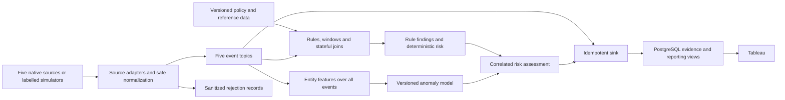

# SPA implementation and revamp plan

Planning baseline: 5 October 2026. Status: proposed implementation plan, based on source review and two targeted mapper checks. Existing deployment status and performance results were not reverified during this planning pass.

## 1. Scope and recommendation

Use [SPA.md](../next/SPA.md) as the requirements reference. Retain the existing pipeline and complete its AI governance behavior. The earlier eight-producer, ten-framework HTML is architectural background; adding its extra producers is outside this plan.

The target has five producer groups:

1. Keycloak: identity, authentication and administrative activity.
2. Kubernetes audit: access, RBAC and model-serving workloads.
3. Airflow/OpenLineage: execution, lineage, drift and bias measurements.
4. Model registry: registration, approval and production promotion.
5. LLM gateway: request/response policy checks and inference metadata.

The five mapping targets are NIST AI RMF 1.0, ISO/IEC 42001:2023, EU AI Act, NIST SP 800-53 Rev. 5 and GDPR. A finding routes evidence to applicable controls; it does not establish compliance with an entire framework. Each association needs a rationale and an applicability decision.

SPA.md mixes requirements, alternative designs, suggested numbers, copied conversation, illustrative code and unverified factual claims. The sixteen-rule table is the starting functional specification. Its sample commands, costs, completion percentages and regulatory statements are not execution instructions or verified project results.

### Retain

- Five independent source adapters and their versioned Kafka topics.
- The common event contract, Kafka Streams engine, separate risk scorer and PostgreSQL sink.
- Terraform, EKS/MSK/RDS deployment scaffolding and Tableau views.
- Existing unit tests, labelled fixtures and local evaluation tooling as the regression baseline.

### Change

- Reconcile the sixteen requested scenarios with the sixteen different rules currently implemented.
- Complete native-source normalization and policy enrichment.
- Repair event identity and delivery handling before scaling the corpus.
- Add the entity feature stream and independent ML evaluation described in SPA.
- Build repeatable source demonstrations, a coverage dashboard and evidence-backed reporting.

## 2. What the review establishes

| Area | Observed implementation | Planning consequence |
|---|---|---|
| Source services | Five adapters exist. Local Compose starts adapters, broker and processing services; it does not start the actual Keycloak, Kubernetes or Airflow sources. | An adapter endpoint is not evidence of an installed native source. Add source launch/configuration and end-to-end fixtures. |
| Rules | Sixteen entries exist, but several implement different controls from SPA's R1–R16. | Preserve stable IDs and introduce an explicit SPA rule profile. |
| Normalization | Several rules depend on supplied flags such as `cross_namespace`, `change_approved`, `pii_detected` and `model_approved`. | Derive evidence from native records or trusted policy/detector services; test raw source payloads. |
| Lineage identity | START and COMPLETE for the same OpenLineage run use the same source ID, which produces the same canonical event ID. The sink ignores duplicate event IDs. | Lifecycle evidence can be lost in persistence. Correct identity before collecting a dataset. |
| Kubernetes identity | A sample service-account read from `team-a` against a secret in `team-b` mapped the actor namespace to `team-b` and left `cross_namespace=false`. | Derive requester identity separately from the resource namespace. |
| Risk | The scorer reads rule findings only, trains on recent findings, and uses the larger of baseline and ML scores. | It cannot detect behavior that never generated a rule finding. Implement SPA's all-event feature path and held-out evaluation. |
| Framework catalog | Mappings are bundled into the Java application and the loader requires exactly sixteen entries. | Externalize versioned metadata and replace the fixed count with profile validation. |
| Evaluation | The results document reports 72-event local runs and an adapter smoke test. | Useful regression evidence, not a sustained throughput study, complete source integration test or AWS failover result. |
| Presentation | SPA contains target volumes, placeholder EDA, provisional completion percentages and draft citations. | Generate final tables from measured runs and a verified source register. |

Evidence inspected: [mappers](../services/producer_adapters/common/mappers.py), [adapter runtime](../services/producer_adapters/common/runtime.py), [topology](../stream-processor/src/main/java/io/governance/streams/GovernanceTopology.java), [stateless rules](../stream-processor/src/main/java/io/governance/rules/StatelessRuleEngine.java), [rule catalog](../config/rules.yml), [catalog loader](../stream-processor/src/main/java/io/governance/rules/RuleCatalog.java), [risk scorer](../services/risk-scorer/scorer.py), [risk service](../services/risk-scorer/app.py), [sink](../services/postgres-sink/app.py), [evaluation results](../evaluation/RESULTS.md) and [Compose](../docker-compose.yml).

The two mapper checks above executed pure normalization functions with fabricated records. No live source, cloud resource or database was changed by those checks.

## 3. Rule reconciliation

SPA labels describe requirements; `GOV-*` identifiers describe stored implementation records. Do not infer equivalence from matching numbers or relabel historical findings.

| SPA rule | Requested behavior | Current counterpart | Work required |
|---|---|---|---|
| R1 | Five failed logins per user in a five-minute window | GOV-001 | Retain the window; align severity, isolate identities by realm/tenant, and test boundaries, duplicates and late arrivals. |
| R2 | Sensitive role grant outside the change window | GOV-002, partial | Current check uses an approval flag. Add native admin-event parsing, privileged-role inventory and timezone-aware change-window lookup. |
| R3 | Registry/gateway login without MFA evidence | GOV-003, partial | Establish client scope and trustworthy MFA evidence. Distinguish missing evidence from confirmed lack of MFA. |
| R4 | cluster-admin binding created or patched | GOV-004, partial | Record the binding event regardless of approval; represent authorized exceptions explicitly instead of silently suppressing evidence. |
| R5 | Secret read across requester/resource namespaces | GOV-005, partial | Fix native identity derivation; define authorized cross-namespace access and handling for human users without a workload namespace. |
| R6 | Unapproved image on create/update in model-serving namespaces | GOV-006, partial | Add update/patch and deployment-template coverage, namespace scope and a trusted image inventory. Separate any privileged-pod extension. |
| R7 | Unscheduled manual training/production DAG trigger | Missing; propose GOV-017 | Add run type, schedule, initiator, approved exception and DAG metadata lookup. A running DAG alone is not proof of a manual trigger. |
| R8 | Input dataset has no owner | GOV-007, partial | Preserve native input datasets and join versioned ownership state. Keep unknown/missing lookup state visible. |
| R9 | PSI/KS drift threshold exceeded | GOV-009, partial | Implement metric-specific comparison directions and thresholds. Report drift even when remediation starts; track remediation separately. |
| R10 | Demographic-parity gap or disparate-impact ratio breaches policy | GOV-010, partial | Support both greater-than and less-than comparisons, sample-size checks, metric provenance and exception state. |
| R11 | Production promotion without approved status | GOV-011, partial | Support pending, approved, rejected and revoked status; check evidence validity at promotion time and handle out-of-order delivery. |
| R12 | Same person registers and approves a model version | Missing; propose GOV-018 | Join registration and approval identities for the same immutable version; distinguish human actor from service identity. |
| R13 | Registration missing owner, dataset ID or evaluation metrics | Missing; propose GOV-019 | Evaluate required metadata and retain missing-field evidence. GOV-013's signature check is a separate control. |
| R14 | PII in prompt or response without an allowed handling path | GOV-014, partial | Add actual detector execution before durable logging and coverage of responses. Store safe evidence and detector version. |
| R15 | Inference missing model version, request ID or user ID | Missing; propose GOV-020 | Preserve missing source fields instead of hiding them behind defaults. Assign a separate collector ID so malformed business metadata remains auditable. |
| R16 | Invocation uses an unapproved model | GOV-015, partial | Resolve approval against a versioned model inventory; avoid trusting an unverified caller flag. |

Retain GOV-008 (schema versioning), GOV-012 (evaluation before promotion), GOV-013 (artifact signature) and GOV-016 (injection/exfiltration signals) as separately labelled extensions. The proposed catalog supports twenty controls; the SPA core profile selects exactly sixteen. Update feature encodings, documentation, catalog validation and evaluation fixtures together. New IDs are a planning proposal, not an applied migration.

Every core rule needs a requirement alias, severity policy, input contract, predicate, state dependencies, exception behavior, evidence fields, mapping version, and positive/negative/boundary fixtures. Add event-type validation for rule-critical attributes. Missing or invalid telemetry must not silently count as a passing control.

## 4. Target flow

Keep existing source and finding topics compatible where possible. Add separate policy-state, entity-feature, risk-assessment and late-event topics only with explicit contracts, retention, partition keys and readers. Preserve rule findings during ML warm-up or outages. An anomaly without a rule hit remains an anomaly assessment, not an invented framework violation.

## 5. Ordered work packages

### P0 — Requirements, contracts and migration design

Deliverables:

- A canonical SPA profile and the crosswalk above in machine-readable form.
- A normalized event contract that retains source identity, event identity, correlation/run identity, schema version, source time and collection time separately.
- A finding contract supporting multiple rules per source event, multiple evidence references, policy/mapping versions, and evaluation status.
- Event identity rules: retries reproduce IDs; distinct lifecycle states remain distinct; Kubernetes audit stages are deliberately selected or represented separately.
- A compatibility plan for existing topics, stored findings and dashboards. Use a version change if identity or schema behavior is incompatible; do not silently mix historical semantics.
- Decisions on severity, missing evidence, approved exceptions, event-time lateness, and core versus extension controls.

Exit check: all sixteen SPA requirements map to a defined predicate, required evidence, implementation ID and independent expected-result fixture. No rule is considered complete merely because a similarly numbered catalog entry exists.

### P1 — Correct ingestion and evidence delivery

Work:

- Repair OpenLineage event IDs; preserve inputs, outputs and relevant ownership/schema facets.
- Correct Kubernetes requester identity, namespace handling and native create/update/patch mappings.
- Parse Keycloak admin events and define where client roles, MFA evidence and change approvals originate.
- Implement metadata-quality reporting for absent source IDs, actors and model versions; keep ingestion identity separate from missing business fields.
- Build a redaction/detection boundary before Kafka, error messages and any other durable logging for prompt/response content. Audit rejection messages and supplied redacted excerpts as well as accepted payloads.
- Validate source authentication and trusted enrichment provenance before exposing adapters beyond the local demo.
- Check Kafka delivery callbacks and timeouts before acknowledging requests or committing input offsets. The risk service currently flushes and commits without checking successful delivery.
- Define bounded retry, sanitized rejection handling and replay. Use an event-type contract for rule-critical values rather than unrestricted attributes alone.

Primary files: adapter mappers/runtime/tests, event schema, risk service and sink recovery tests.

Exit check: native START and COMPLETE both persist; repeating either creates no extra logical record; the cross-namespace fixture is classified correctly; injected delivery failures do not become acknowledged-but-lost evidence; PII markers are absent from all configured durable outputs.

### P2 — Complete rules, reference state and mapping lifecycle

Work:

- Implement the four missing core checks and align the twelve partial/existing counterparts.
- Add versioned reference data for dataset owners, model approvals, model inventory, DAG schedules, change windows and image inventory, with compacted topics where appropriate.
- Handle approval revocation, failed evaluation updates, expiration and late arrival. A prior approval must not remain permanently valid by omission.
- Isolate state keys by tenant/realm and immutable resource version. Record the exact evidence and policy versions used for each finding.
- Add explicit late-event disposition and reconciliation; a grace period alone is not a documented late-event path.
- Externalize framework metadata with validated, atomic updates. Preserve the mapping version on historical findings.
- Assess each mapping against the applicable framework edition, system role and control purpose. Unsupported combinations remain unmapped with an explanation.

Primary files: rule catalog/loader, Java predicates/topology/models, schema contracts and reference-data tooling.

Exit check: the SPA profile passes all sixteen independent scenarios, their benign counterparts and relevant state/ordering cases; mapping updates do not change historical evidence or require an application rebuild.

### P3 — Five-producer demonstration and corpus generation

Recommended demo configuration:

| Producer | First demonstration | Evidence shown |
|---|---|---|
| Keycloak | A real local realm and event listener | Login failures, role change and MFA state derived from source activity. |
| Kubernetes | A local kind cluster with audit collection | RBAC change, cross-namespace access and image policy checks. Use CloudWatch forwarding for the EKS variant. |
| Airflow/OpenLineage | One small actual DAG plus controlled metric scenarios | START/COMPLETE, inputs/outputs, owner lookup, unscheduled trigger, calculated drift and bias. Label synthetic metrics when used. |
| Model registry | A deterministic local registry simulator | Registration, approval, rejection, self-approval and promotion in a visible sequence. |
| LLM gateway | A local test gateway and fabricated prompts/responses | Detector output, redaction, missing metadata and approved-model checks without requiring paid inference. |

Keep native, synthetic and replayed provenance visible in event metadata and dashboards. AWS-native SageMaker and Bedrock integrations form a later integration milestone; the demo can share the same contracts without claiming all events came from those services.

Deliver a seeded baseline generator, a scenario command per SPA rule, ground-truth manifest, source-to-adapter scenario runner, JSONL capture and replay, and a ten-minute rehearsal. Engine-only injection remains a separate test mode; it must not replace adapter/source validation.

The chained demonstration uses a shared actor/correlation identity: failed logins → privileged role grant → unapproved promotion → PII handling violation. Show normal cases before and after it. Demonstrate recovery locally; schedule disruptive cloud tests separately.

Exit check: all five sources have a normal path and a violation path with visible provenance, source events, findings and database/dashboard evidence; replay reproduces the expected detections with a documented event-time strategy.

### P4 — Risk model and independent evaluation

Work:

- Implement SPA's deterministic risk formula as a versioned experiment: severity, asset criticality, prior frequency, entity recency and the proposed framework-breadth factor. Compare a breadth factor of one so adding a mapping cannot be mistaken for new empirical impact.
- Aggregate features from benign and violating events per entity/window. Include counts, resource/IP diversity, error/off-hours ratios, detector rates and drift/bias metrics.
- Train on a declared baseline segment; use separate chronological validation and test segments. Score held-out examples before any retraining can include them.
- Save model, feature schema, seed, training interval, calibration and score-policy versions. Make scoring reproducible across replicas and restarts.
- Compare deterministic, anomaly-only and hybrid outputs. SPA's 0.7/0.3 blend is a starting hypothesis to validate; keep policy findings visible regardless of the blend.
- Report rule precision/recall/F1 separately from risk ranking PR-AUC and false-positive rate. Include the recency ablation requested by SPA.

The existing finding-only scorer is a retained comparator, not proof of anomaly detection outside rule coverage. The distinction between training on a clean baseline and outlier-contaminated training is described in the [scikit-learn guide](https://scikit-learn.org/stable/modules/outlier_detection.html).

Exit check: the model can score a held-out entity window with no rule finding; all published comparisons identify data split, label definition, calibration and model version; no superiority claim is made without measured support.

### P5 — Reporting, AWS validation and final documentation

Work:

- Retain framework findings, risk trend and incident history; add drift/bias, entity risk, source freshness, telemetry coverage, mapping version and pipeline health.
- Distinguish evaluated/no finding, finding, missing evidence and not applicable. A zero finding count is not a compliance percentage.
- Define aggregation grain so findings mapped to several controls do not unintentionally receive extra weight in average risk.
- Measure actual Tableau refresh behavior; do not promise a five-second refresh solely because a connection is live.
- Complete EKS control-plane forwarding, optional native cloud producer bridges and AWS Glue Schema Registry integration with a compatibility test.
- Validate IaC against the chosen region and supported versions. Reconcile SPA's two-AZ/three-broker description with the actual broker/AZ layout.
- Produce a fresh region-specific budget for the chosen run duration and service mix. Treat SPA's old cost table as unverified; inventory stateful resources before any later shutdown/cleanup procedure.
- Run controlled AWS reliability tests only after the local gates. Preserve run IDs, input/output reconciliation, lag history, configuration and failure timestamps.
- Update the setup guide, architecture, producer contracts, rule traceability, measured results and seven-slide narrative to the same scope/version.

Exit check: a rehearsed demo and a reproducible evidence bundle support every implementation, performance and framework-mapping claim in the presentation.

## 6. Dataset and measurement plan

SPA's proposed producer volumes sum to about 655,000 events before accounting for how violation scenarios add or reuse events. Sixteen rules × fifty scenarios gives 800 scenarios, not necessarily 800 events: a failed-login scenario alone spans several events. Record both event count and scenario count.

Use distinct profiles:

| Profile | Purpose | Proposed scale and completion condition |
|---|---|---|
| Regression | Catch logic and integration changes quickly | Every core rule has benign, violating, boundary and applicable ordering cases; fixed seeds and expected results. |
| Demonstration | Explain behavior live | Short normal-traffic run, one scenario per rule and the chained story; labelled source mode and replay fallback. |
| Research corpus | Measure accuracy and ranking | Work toward SPA's 500k–1M target and 30–50 held-out violation scenarios per rule, with baseline/validation/test separation and more than one seed. |
| Load | Find sustained capacity | Increase offered rate through feasible steps, including SPA's 1k/5k/10k goals only when hardware supports them; record actual accepted rate, lag and recovery. |

The demo's suggested 20–50 events/second and a week-long 655k-event research corpus are different traffic profiles. Do not apply the short-demo rate continuously and report the smaller weekly total.

Measure collection delay (`ingested_at - event_time`), processing delay (`detected_at - ingested_at`), persistence delay and total source-to-storage delay separately. AWS documents that EKS audit-log delivery can take minutes and is best effort, so an application-processing latency goal is not a universal source-to-dashboard guarantee. [AWS EKS logging](https://docs.aws.amazon.com/eks/latest/userguide/control-plane-logs.html).

Compute detection metrics per rule and scenario, while preserving event/finding identity. Wait for the declared evaluation horizon and drained backlog before final scoring. Failure tests pass on event/finding reconciliation and recovery evidence, not offsets alone. Proposed prototype targets of precision/recall ≥0.95 and processing p95 ≤5 seconds require a declared workload and separate outage measurements.

Use UCI Adult for the small model and bias experiment, and Loghub only for the separately defined log-anomaly comparison. They are supporting datasets, not native governance event corpora. Verify downloaded versions, licenses, preprocessing and actual counts. [UCI Adult](https://archive.ics.uci.edu/dataset/2/adult).

## 7. Evidence and factual claims

Create a claim register before revising slides: claim, source, publication date, retrieval date, page/section, verified value, scope and status.

- IBM's current primary page supports the 2026 $4.99M global average breach cost and 56% increase in AI-driven attacks. The other SPA percentages and precise attack-cost figures still require report-level checking. Do not attach a general IBM URL to a figure that has only been found in a secondary summary. [IBM report page](https://www.ibm.com/reports/data-breach).
- The European Commission currently reports the AI Omnibus entry into force on 27 July 2026 and the Annex III/Annex I dates of 2 December 2027 and 2 August 2028. Verify the linked legislative text, scope and applicable system role before publishing control applicability. This confirms selected dates, not SPA's entire legal mapping. [Commission notice](https://digital-strategy.ec.europa.eu/en/news/ai-omnibus-enters-force).
- Verify incident descriptions, enforcement amounts and later procedural outcomes against first-party disclosures or regulator/court decisions. A related incident is motivation; it is not evidence that this prototype detects the full incident.
- Validate all twenty-seven literature entries for title, authors, year, venue and working DOI/URL. Label blogs and standards separately from papers. Keep the novelty claim provisional until related work has been searched.
- Replace provisional completion percentages and EDA placeholders with outputs from dated runs.

Resolve SPA's privacy conflict explicitly: Bedrock invocation logging can store complete request and response content in CloudWatch/S3. A Lambda that redacts after that storage cannot satisfy a requirement to sanitize before any persistence. Prefer the gateway boundary for this requirement and document the logging policy. [AWS Bedrock invocation logging](https://docs.aws.amazon.com/bedrock/latest/userguide/model-invocation-logging.html).

## 8. First implementation batches and dependencies

| Order | Batch | Completion evidence |
|---|---|---|
| 1 | Rule profile, canonical contracts and migration decisions | Sixteen-row requirement map; existing IDs preserved; profile validation and fixture definitions. |
| 2 | Native event identity, namespace correction and delivery handling | Lifecycle/retry, native cross-namespace, delivery-failure and evidence-sanitization regression checks. |
| 3 | Four missing rules and reference-state enrichment | Positive/negative scenarios for GOV-017–020 plus aligned existing core rules and ordering checks. |
| 4 | Real source demo setup, scenario runner and replay | Five-source rehearsal, traceable ground truth and deterministic replay. |
| 5 | All-event feature stream, model artifacts and held-out comparison | Reproducible baseline/anomaly/hybrid results with declared datasets and labels. |
| 6 | Reporting, cloud integration and final evidence pack | Measured dashboard behavior, AWS validation results and reconciled documentation. |

Dependency order: P0 → P1 → P2 → P3. P4 depends on trustworthy ingestion and the corpus generator. P5 reporting can start after P2, while final evaluation and publication depend on P3/P4. Source and literature verification can progress independently throughout.

No calendar deadline, spending cap or cloud test window has been set by the user. Use these completion gates for scheduling until those constraints are supplied. The proposed work is an incremental extension of the current project; this planning document does not mark any implementation task complete.
